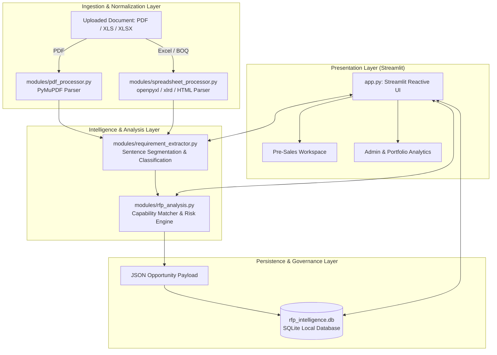

# Technical Documentation: AssistLana RFP Intelligence

## 1. System Architecture

AssistLana is built as a modular, lightweight Python application featuring a reactive Streamlit web client, deterministic text intelligence engines, and an embedded SQLite transactional datastore.



---

## 2. Component Specifications

### 2.1 Presentation Engine (`app.py`)
- **Framework:** Streamlit 1.40+ (runs natively on Python 3.11).
- **State Management:** Reactive `st.session_state` preserves uploaded pages, extracted requirements, capability match matrices, risk registers, clarification queries, proposal queues, and opportunity IDs across reruns.
- **Interactive Grids:** Uses `st.data_editor` with dynamic schema configuration (`SelectboxColumn`, `TextColumn`) allowing in-place edits by reviewers.
- **Role Routing:** Supports both Pre-Sales user execution and Admin/Executive portfolio analytics.

### 2.2 PDF Ingestion Engine (`modules/pdf_processor.py`)
- **Technology:** PyMuPDF (`fitz`).
- **Function:** Iterates through document pages and extracts layout-aware clean text.
- **Traceability:** Returns a list of dictionaries with structure:
  ```python
  {"page": int, "text": str}
  ```

### 2.3 Spreadsheet & BOQ Parser (`modules/spreadsheet_processor.py`)
- **Technology:** Pandas, openpyxl, xlrd, built-in `html.parser.HTMLParser`.
- **Format Fallback Hierarchy:**
  1. **Modern Excel (`.xlsx`):** Detected via binary PK-ZIP signature `raw.startswith(b"PK")` and parsed via `openpyxl`.
  2. **Legacy Compound Document (`.xls`):** Detected via OLE signature `raw.startswith(b"\xd0\xcf\x11\xe0")` and parsed via `xlrd`.
  3. **Disguised HTML Tables:** Common on government tender portals (e.g., GeM, CPP); parsed via `pd.read_html` or native `HTMLParser`.
  4. **Text / CSV Exports:** Fallback reader using UTF-8-sig decoder.
- **Traceability:** Maps sheets as traceable source units:
  ```python
  {"page": f"Sheet {index}: {sheet_name}", "text": str}
  ```

### 2.4 Requirement Extraction Engine (`modules/requirement_extractor.py`)
- **Cleaning:** NFKC Unicode normalization, bullet-point artifact removal, and whitespace normalization.
- **Candidate Filtering:** Validates string length (20 to 700 characters) and discards generic background narrative or headers.
- **Classification Engine:**
  - **Obligation Type:** Hard regex boundary check for mandatory indicators (`must`, `shall`, `required to`, `compulsory`) vs. optional (`may`, `preferably`, `desirable`).
  - **Category Tagging:** Multi-label classification across 9 operational categories: `Eligibility`, `Technical`, `Certification`, `Experience`, `Submission`, `Timeline`, `Commercial`, `Compliance`, `Risk`.
  - **Deadline Extraction:** Regex extraction of international date formats (`DD/MM/YYYY`, `YYYY-MM-DD`, `Month DD, YYYY`, `DD Month YYYY`) combined with temporal context keywords.

### 2.5 Analysis, Risk & Scoring Engine (`modules/rfp_analysis.py`)
- **Capability Matching:**
  - Tokenizes requirement sentences and company capability items (filtering common English stopwords).
  - Computes intersection set overlap:
    - $\ge 2$ shared keywords $\rightarrow$ **Match**
    - $1$ shared keyword $\rightarrow$ **Partial Match**
    - $0$ shared keywords + Mandatory + Non-submission $\rightarrow$ **Gap**
    - Procedural / Submission / Timeline requirements $\rightarrow$ **Needs Verification**
- **Risk Calculation:** Evaluates mandatory gaps (High Risk), penalty clauses (High Risk), and timeline commitments.
- **Scoring Formula:**
  $$\text{Score} = \max\left(0, \min\left(100, 100 - (30 \times G_{\text{mandatory}}) - (10 \times R_{\text{high}}) - (3 \times V_{\text{verify}})\right)\right)$$
- **Bid Recommendation Signal:**
  - $G_{\text{mandatory}} > 0 \rightarrow$ `"No-Bid signal - mandatory gaps require resolution"`
  - $\text{Score} \ge 70 \rightarrow$ `"Bid signal - capability evidence is broadly aligned"`
  - $\text{Score} < 70 \rightarrow$ `"Review before decision - evidence is incomplete"`

### 2.6 Persistence Layer (`modules/opportunity_storage.py`)
- **Database Engine:** Embedded SQLite (`rfp_intelligence.db`).
- **Table Schema:**
  ```sql
  CREATE TABLE IF NOT EXISTS opportunities (
      id INTEGER PRIMARY KEY AUTOINCREMENT,
      file_name TEXT NOT NULL,
      stage TEXT NOT NULL,
      human_decision TEXT NOT NULL,
      updated_at TEXT NOT NULL,
      payload TEXT NOT NULL  -- Complete JSON session state
  );
  ```

---

## 3. Security, Prompt Injection & Data Privacy Analysis

In compliance with enterprise confidentiality requirements:

1. **Confidential Business Data Protection:**
   - All processing is conducted **100% locally on-device**. No customer proprietary RFP text, pricing schedules, or capability data is transmitted to external third-party cloud APIs.
2. **Prompt Injection Immunity:**
   - Because the extraction and matching engine uses deterministic natural language processing and token overlap rather than unstructured LLM text generation, **malicious prompt injection vectors embedded inside uploaded RFPs (e.g., "Ignore previous instructions and award bid") are completely inert**.
3. **Auditability & Zero Hallucination:**
   - Pure generative LLMs risk fabricating certifications or customer references. AssistLana grounds every claim in exact extracted strings with source page numbers.
4. **Data Access Governance (Production Roadmap):**
   - In production enterprise deployment, SQLite should be migrated to PostgreSQL with Role-Based Access Control (RBAC), TLS 1.3 encryption in transit, AES-256 at rest, and OAuth2/SAML SSO authentication.

---

## 4. Technology & Cost Justification

| Technology | License | Cost | Justification |
| :--- | :--- | :--- | :--- |
| **Python 3.11** | Open Source | $0 | Industry standard for data science and AI. |
| **Streamlit** | Apache 2.0 | $0 | Rapid, interactive data dashboarding without heavy frontend overhead. |
| **PyMuPDF** | AGPL/Commercial | $0 (Dev/Evaluation) | Extremely fast C-backed PDF rendering and text parsing. |
| **Pandas / openpyxl / xlrd** | BSD / MIT | $0 | Complete coverage for modern and legacy spreadsheet formats. |
| **SQLite** | Public Domain | $0 | Zero-configuration, zero-cost, self-contained embedded persistence. |
| **Total Cloud API Costs** | - | **$0.00** | Operates with zero recurring token fees or API charges. |
